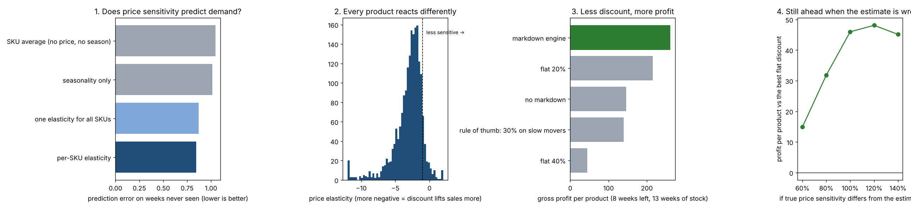

# Markdown Engine: Which Products to Discount, and by How Much

[](https://github.com/f20220970-debug/snitch-markdown-engine/actions/workflows/tests.yml)

**[Live demo](https://f20220970-debug.github.io/snitch-markdown-engine/)**: pick a product, set its stock, get a recommended discount.

## In 30 seconds
- Measures **how much each product's sales respond to price** from real week-to-week price movement, then turns that into a weekly markdown list.
- On 1,939 products it earns **more gross profit with a 14.6% average discount than the best flat 20% discount does** — about **46 more per product** over an 8-week run-out, and it wins in all nine stock-and-season scenarios tested.
- The demand model cuts prediction error **19%** against a per-product average, on **21,572 product-weeks it never saw**.

Built for **Snitch's PS-II internship**, aimed at the Business Analyst (Growth) brief, "grow online gross
profit by optimising discounts", and the Marketplace Analyst brief, "STR, DOI, ROS, CVR and returns ... turn
them into recommendations on inventory and pricing".

> **Real data, used as a stand-in.** 541,909 transaction lines from a public online-retail dataset
> (Dec 2010 – Dec 2011): real prices that move week to week, and real cancellations. Snitch's own sales data
> is private. The method transfers; the numbers will not.



## The question
A product has stock left and a few weeks of season left. Discount too little and it is still sitting there in
January. Discount too much and margin is given away on units that would have sold anyway. The answer depends
on something most teams never measure: **how much extra does this particular product sell when it is cheaper?**

## Step 1: measure price sensitivity per product
For each product: `log(units) = a + e·log(price) + s·log(store-wide demand that week)`.
`e` is the elasticity; the seasonality term keeps a Christmas rush from being read as a price effect.
Estimates from short histories are pulled towards the overall average, so a product with 8 noisy weeks is not
trusted like one with 40.

**It is tested, not assumed.** Fit on weeks 1–40, predict units in weeks 41–53:

| Demand model | Error on weeks never seen | vs product average |
| --- | --- | --- |
| Product average | 1.047 | — |
| + seasonality | 1.012 | 3% better |
| + one elasticity for all products | 0.872 | 17% better |
| **+ elasticity per product** | **0.845** | **19% better** |

Median elasticity is **−2.70**, and **97% of products are negative** (cheaper really does sell more), which is
the sanity check that the measurement is picking up something real. The spread is wide: some products barely
react, some react four times as much, which is exactly why one flat discount is the wrong tool.

## Step 2: choose the discount
```
weekly demand at discount x = base demand × (1 − x)^elasticity
units sold                  = min(stock, weeks × demand)
gross profit                = units × (price×(1−x) − cost) + leftover × (salvage − cost)
```
The engine tries every 5% step from 0% to 60% and takes the best.

**Assumptions, not data** (this dataset has no cost or stock figures; both are inputs you can change):
cost = 55% of price, salvage = 20% of price, and stock is expressed as *weeks of cover at full price*
so no single invented number drives the result.

## Step 3: does it beat the alternatives?
Every policy picks its discount using elasticity fitted on **earlier weeks only**, then is scored against
elasticity fitted over the whole period: it is judged on decisions made with the information it really had.
8 weeks left, 13 weeks of stock, 1,939 products:

| Policy | Avg discount | Sell-through | Gross profit per product |
| --- | --- | --- | --- |
| No markdown | 0% | 62% | 146 |
| Flat 20% on everything | 20% | 95% | 215 |
| Flat 40% on everything | 40% | 99% | 44 |
| Rule of thumb: 30% on slow movers | 30% | 98% | 139 |
| **Markdown engine** | **14.6%** | **92%** | **261** |

**Less discount, more profit.** The flat 20% rule clears more stock and earns less, because it discounts
products that would have sold anyway. The engine wins in **all nine** combinations of 4/8/12 weeks left and
8/13/20 weeks of stock.

**What if the elasticity is wrong?** Even if true sensitivity is only 60% of the estimate, the engine still
beats the best flat discount (+15 per product); at 140% it is +45.

## Returns
Overall return rate is **3.67%**, but it is concentrated: **70 products with return rates above 10% account
for 65% of all returned units**. A returned unit is a sale that undoes itself, so those products should be
fixed or dropped before they are discounted into higher volume.

## What a merchandiser actually gets
- `results/markdown_list.csv` — every product with rate of sale, weeks of cover, return rate, recommended
  markdown and the sell-through it would produce.
- `markdown_calculator.xlsx` — a single-product calculator (change the yellow cells, read the best discount
  off the grid) plus this week's top 60 list. All live formulas, no hardcoded answers.
- The [live demo](https://f20220970-debug.github.io/snitch-markdown-engine/) for the same thing in a browser.

## A mistake worth recording
The first version of the comparison reported the engine as **"+1,243% gross profit"** in one scenario. That
was not a result, it was a divide-by-almost-zero: with deep stock and no markdown, profit is near zero or
negative once leftover is written down below cost, and a percentage against that base is meaningless. All
comparisons are now in money per product, which cannot flip sign.

## Run it
```bash
pip install -r requirements.txt
python src/get_data.py          # downloads the transactions (~23 MB)
python run.py                   # everything above -> results/
python src/plot.py              # -> docs/results.png
python src/build_workbook.py    # -> markdown_calculator.xlsx
pytest -q                       # 6 tests, including recovering a known elasticity from simulated data
```

## Limitations and next steps
- **Elasticity here is observational.** Prices were not set at random, so this is an association. At Snitch the
  honest version is a price test: hold out a set of products, discount them at random depths, and measure.
  That is the first thing I would propose.
- No cost, stock or traffic data, so margin and stock are inputs rather than measurements, and conversion
  rate cannot be modelled separately from demand.
- A UK gift retailer, not Indian menswear. Fashion adds size curves and seasons; the same method applies at
  size-and-colour level once that data exists.
- Next: cannibalisation between similar products, and a returns-aware objective so a discount that drives
  returns is not counted as profit.

Built by Pavitra Seth (BITS Pilani) as preparation for Snitch's PS-II. Not affiliated with Snitch.
